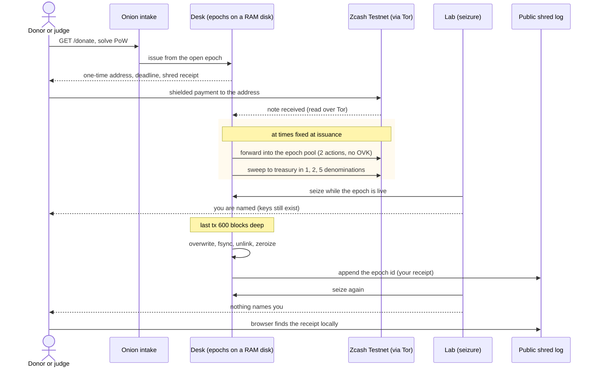

# Amnesia

### A donation desk that forgets.

Amnesia is a Zcash donation desk built to forget its donors. Every donor gets a one-time shielded address. A few hours after that address's deadline, the desk destroys every key that could link the payment back to it. Seize the server after that and there is nothing left to read: not in the wallet files, not in the logs, not in the process memory. A normal wallet, seized the same way, names every donor it ever had.

 

-F4B728)

-7D4698?logo=torproject&logoColor=white)

**[Live demo](https://amnesia.taila8827e.ts.net)** · **[Security model](SECURITY.md)** · **[Run your own desk](https://amnesia.taila8827e.ts.net/operate)**

---

## The problem

Anyone who takes donations keeps a list of donors, whether they mean to or not. A normal wallet stores every incoming payment, the address it arrived on, and the time. That database is the donor list. It outlives the campaign, it outlives the people who promised to protect it, and it is the first thing taken when a server is seized, subpoenaed, breached or sold.

This is not hypothetical:

| What happened | Source | Date |
|---|---|---|
| "GiveSendGo suffers hack related to 'Freedom Convoy', data leaked": donor names, emails, zip codes and IP addresses | [Global News](https://globalnews.ca/news/8618116/givesendgo-suffers-hack-related-to-freedom-convoy-data-leaked) | Feb 14, 2022 |
| US Supreme Court strikes down California's demand for charities' donor lists (Schedule B), 6 to 3, citing the chilling effect even of confidential disclosure | [Congressional Research Service](https://www.everycrsreport.com/reports/LSB10621.html) | Jul 1, 2021 |
| *NAACP v. Alabama*: the Court blocks a state from forcing the NAACP to hand over its membership list, because exposure invites harassment and reprisal | [Congressional Research Service](https://www.everycrsreport.com/reports/LSB10621.html) | 1958 |

Courts can protect a list. Breaches and seizures ignore that protection. The only list that cannot leak is one that no longer exists.

Zcash already hides payments on chain. It does not help once the receiver's own wallet is taken: the wallet can decrypt everything it ever received. The protocol request for this, forward unspendability with keys you can provably throw away, has been open for years: [zcash/zcash#2044](https://github.com/zcash/zcash/issues/2044). Amnesia builds it as a product.

## The solution

1. A donor opens the desk's onion address in Tor Browser, solves a short proof of work, and gets a **one-time Orchard address**, a deadline and a **shred receipt**.
2. The donor pays from any shielded wallet. The desk forwards the payment into its epoch's pool at a time it fixed when the address was issued, then sweeps the pool to the organisation's treasury in round denominations.
3. Once the epoch's last transaction is 600 blocks deep, the desk **overwrites, fsyncs and deletes every key of that epoch**, zeroizes them in memory, and writes one line to a public shred log: the epoch id (the donor's receipt), rounded hours and a bucketed count.

**In plain terms:**
- **Nothing to sign up for.** No account, no wallet connection, no cookie. One onion link and a payment.
- **Nothing to leak later.** After the shred, a full copy of the server cannot say who paid. A normal wallet can, forever.
- **Checkable by the donor.** The shred receipt appears in the public log only when the keys are gone. The donor's browser checks it locally, so the desk never learns whose receipt is being checked.
- **Honest about the gap.** While an epoch is live its keys exist, and a seizure in that window can read them. The demo shows that too.

## Try it in two minutes

1. **Donate** at [/donate](https://amnesia.taila8827e.ts.net/donate). No wallet needed: the lab's simulated exchange pays a fresh Amnesia address and a normal wallet the same amount, from real testnet funds. You get a client id like `you-da1d`, the block it was mined in, the time its keys will be destroyed, and a shred receipt.
2. **Seize both** at [/seize](https://amnesia.taila8827e.ts.net/seize). The lab copies the desk's files and RAM-disk epochs, scans them for keys and receipts, and matches them against the exchange's withdrawal records. Your id is highlighted. The normal wallet names you. Amnesia names you too, because your epoch is still live.
3. **Come back after the shred.** When your receipt appears in the [public log](https://amnesia.taila8827e.ts.net/audit), the keys are gone. Seize again and Amnesia no longer names you. The home page tracks all four steps for you.
4. **Run your own** at [/operate](https://amnesia.taila8827e.ts.net/operate), and **check the claims** at [/verify](https://amnesia.taila8827e.ts.net/verify) (binary hash, build recipe, live parameters, raw endpoints).

Real donors skip the lab: open the onion address in Tor Browser, solve the proof of work (or wait a minute with JavaScript off), and pay the one-time address from any shielded testnet wallet.

---

## The full lifecycle, step by step, with a real example

Every number below is from one real run on Zcash Testnet on 27 Oct 2026, client `you-da1d`, made through the public demo. Not a simulation, not a mock chain.

**1. Issue.** The donation asks the desk's intake for an address, the same way a real donor does. The desk picks the open epoch, takes the next of its one-time Orchard accounts, and fixes in advance when the funds will move.
> Real: issued 27 Oct 2026, 11:06 UTC. Deadline 14:00 UTC. Shred receipt `50464c8eb364510fb7ad35ccec35c624`, the id of epoch `50464c8e…`. Amount 0.0092 TAZ (920,000 zats).

**2. Pay.** The lab's simulated exchange pays the Amnesia address and, for comparison, a normal wallet the same amount at the same moment.
> Real: desk tx [`cb8692c8…96d8bc`](https://blockexplorer.one/zcash/testnet/tx/cb8692c8fceb955763ec515073ea8bdffcaf0f20f9b8c2254b646efee096d8bc), baseline tx [`3adce537…7c6a91`](https://blockexplorer.one/zcash/testnet/tx/3adce537745df6a4483ad9c6c074e851549060f567ceffbfedfb18ab6c7c6a91). Both mined at block **4,547,228**, 2:42 after broadcast. The explorer shows 0 ZEC for both: the amounts are shielded.

**3. Forward and sweep.** At its pre-drawn slot the desk moves the payment into the epoch pool in a transaction of exactly 2 actions with the standard 10,000 zat fee and no outgoing viewing key. After the deadline plus a random wait, the pool pays the treasury in canonical 1, 2 and 5 notes with a random carry into the next epoch. Every read and broadcast goes over its own Tor circuit, with a random 20 to 120 s delay before each broadcast.

**4. Seize while live.** The lab copies the desk's files and RAM-disk epochs, scans them for keys and receipts, and matches them against the exchange's withdrawal records. It does the same to the normal wallet.
> Real, 27 Oct 2026, 15:45 UTC: the **normal wallet named 25 of 75** withdrawals, `you-da1d` among them, from 1 key in a 4.5 MB image. **Amnesia named 12 of 80**, `you-da1d` among them, because its epoch was still live: 5 live epochs and 256 keys in a 115.6 MB image.

**5. Amount attack on what was already shredded.** With the treasury seed an attacker sees every sweep and tries to match withdrawals to it by amount.
> Real, same seizure: 16 sweeps, 65 candidate withdrawals, **0 pinned**, 65 ambiguous. One sweep alone was consistent with **13,181** different subsets of donations.

**6. Shred.** Once the epoch has swept and its last transaction is 600 blocks deep, its files are overwritten with random bytes, fsynced and unlinked, and seeds are zeroized. The epoch id is appended to the public shred log.
> Real: the predicted window was 18:40 to 23:10 UTC on 27 Oct 2026. Receipt `50464c8e…` entered the [public shred log](https://amnesia.taila8827e.ts.net/audit) as **shredded in the 20:00 UTC hour**, inside the window. 66 epochs have shredded so far, 0 lost.

**7. Seize again.** The same seizure of the whole desk, after the shred.
> Real, 28 Oct 2026, 08:23 UTC: **Amnesia named 4 of 118** withdrawals, all from its 4 still-live epochs, and **`you-da1d` was not among them** (204 keys, 134.5 MB image). The **normal wallet**, seized the same minute, **still named `you-da1d`** at block 4,547,228, along with 34 others. The amount attack pinned **0 of 110** candidates across 22 sweeps; one sweep alone fit 561,642 different subsets.

The demo tells each judge the same thing about their own donation on `/seize`, `/audit` and the home page, from the receipt their browser remembers.

---

## Live deployment

| Surface | Where |
|---|---|
| Judge UI and demo API | [amnesia.taila8827e.ts.net](https://amnesia.taila8827e.ts.net) (Tailscale Funnel to the lab and the read API) |
| Donor intake (Tor Browser) | `http://3ifmcl72upgshv4nbcum4qzwk32whg6vrditxqgzhmfuwttw67slxoqd.onion` |
| Read API | [`/v1/health`](https://amnesia.taila8827e.ts.net/v1/health) · [`/v1/summary`](https://amnesia.taila8827e.ts.net/v1/summary) · [`/v1/shred-log`](https://amnesia.taila8827e.ts.net/v1/shred-log?limit=20) · [`/v1/info`](https://amnesia.taila8827e.ts.net/v1/info) · [`/v1/audit/weeks`](https://amnesia.taila8827e.ts.net/v1/audit/weeks) · [`/v1/treasury`](https://amnesia.taila8827e.ts.net/v1/treasury) |
| Lab API | [`/demo/status`](https://amnesia.taila8827e.ts.net/demo/status) · [`/demo/history`](https://amnesia.taila8827e.ts.net/demo/history) · [`/demo/seizures`](https://amnesia.taila8827e.ts.net/demo/seizures) |
| Running binary | `binary_sha256` and the build recipe in [`/v1/info`](https://amnesia.taila8827e.ts.net/v1/info); compare with your own build |
| Profile | `demo`: 2 h epochs, 2 h grace, 50 addresses per epoch, 600 block burial |
| Host | A Mac under launchd, running since 24 Oct 2026 ([`infra/mac/`](infra/mac/README.md)) |

---

## The stack

| Layer | Technology |
|---|---|
| Desk | Rust 1.93.1, librustzcash (`zcash_client_backend` 0.25, `zcash_client_sqlite` 0.23, `orchard` 0.16), axum 0.8, tokio |
| Network privacy | arti 0.43 for every chain read and broadcast (isolated circuits, no clearnet fallback); tor 0.4.9.14 built with PoW for the donor onion |
| Chain access | lightwalletd at `testnet.zec.rocks`, over Tor only |
| Memory hygiene | Zeroing global allocator, `MallocScribble` on the C heap, epochs on a `ram://` disk, core dumps off |
| Lab | Rust: simulated exchange and bots, seizure and scanner, amount attack, judge API, static UI with a strict CSP and gzip |
| Web | TanStack Start (React 19), TanStack Router and Query, Tailwind 4, GSAP, Motion, three.js |
| Host | macOS launchd agents (desk, lab, tor, keep-awake, watchdog), Tailscale Funnel for the public judge surface |

---

